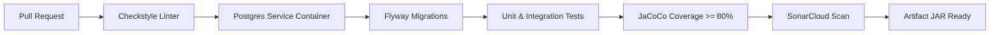

# FleetOps - Microservicio de Mantenimiento

[](https://www.oracle.com/java/)
[](https://spring.io/projects/spring-boot)
[](https://gradle.org/)
[](https://supabase.com/)
[](https://flywaydb.org/)
[](https://www.rabbitmq.com/)
[](LICENSE)

Microservicio encargado de gestionar el **ciclo de vida completo de las órdenes de trabajo de mantenimiento** (preventivo y correctivo) para la flota vehicular corporativa de **FleetCorp**, garantizando trazabilidad, disponibilidad operativa y resiliencia en un ecosistema distribuido.

Proyecto desarrollado para el curso **Desarrollo de Software III (Semestre 2026-1 / 2026-2)** en la **Universidad del Valle - Escuela de Ingeniería de Sistemas y Computación (Célula 3)**.

---

## 🏛️ Arquitectura de Software

El microservicio implementa una **Arquitectura Hexagonal (Puertos y Adaptadores)** estricta, desacoplando completamente las reglas de negocio del framework Spring Boot, los clientes HTTP y la base de datos:

```text
src/main/java/co/edu/univalle/fleetops/mantenimiento/
├── MantenimientoApplication.java           # Punto de entrada (@SpringBootApplication + @EnableScheduling)
│
├── domain/                                 # NÚCLEO: Dominio en Java 21 Puro (Sin dependencias de framework)
│   ├── model/                              # Entidades del negocio y agregados
│   │   ├── MaintenanceOrder.java           # Agregado raíz con ciclo de vida y transiciones
│   │   ├── MaintenanceRule.java            # Reglas preventivas (GLOBAL, CATEGORY, VEHICLE)
│   │   ├── MaintenanceLog.java             # Bitácora cronológica técnica
│   │   ├── MaintenanceLogAttachment.java   # Metadatos de adjuntos
│   │   ├── Technician.java                 # Modelo de técnicos
│   │   ├── OutboxMessage.java              # Mensajes para Transactional Outbox Pattern
│   │   ├── AccessAuditLog.java             # Registro de auditoría de accesos
│   │   └── enums/                          # Catálogos oficiales de estados y tipos
│   ├── exception/                          # Excepciones de negocio (400, 404, 409, 422)
│   └── port/                               # Contratos del hexágono
│       ├── in/                             # Puertos de Entrada (Casos de Uso del Backlog)
│       │   ├── RegisterRuleUseCase.java               # HU-01: Parametrizar reglas preventivas
│       │   ├── ExecutePreventiveInspectionUseCase.java# HU-02: Scheduler preventivo multicriterio
│       │   ├── RegisterManualOrderUseCase.java        # HU-03: Crear orden manual extraordinaria
│       │   ├── ProcessReportedIncidentUseCase.java    # HU-04: Consumidor de incidentes
│       │   ├── QueryOrdersUseCase.java                # HU-05, HU-07: Listado filtrado y paginado
│       │   ├── GetOrderDetailUseCase.java             # HU-06: Detalle con bitácora
│       │   ├── UpdateOrderStatusUseCase.java          # HU-08: Transición de estado y finalización
│       │   ├── RegisterProgressUseCase.java           # HU-09: Avances y revisiones técnicas
│       │   ├── PublishPendingOutboxUseCase.java       # Relay de despacho en background
│       │   └── ManageTechniciansUseCase.java          # Gestión de técnicos
│       └── out/                            # Puertos de Salida (Persistencia e Integración)
│           ├── OrderRepositoryPort.java
│           ├── RuleRepositoryPort.java
│           ├── ProgressRepositoryPort.java
│           ├── TechnicianRepositoryPort.java
│           ├── OutboxRepositoryPort.java
│           ├── VehicleServiceClientPort.java
│           └── EventPublisherPort.java
│
└── infrastructure/                         # PERIFERIA: Adaptadores y Frameworks
    ├── adapter/
    │   ├── in/                             # Adaptadores de Entrada
    │   │   ├── web/                        # REST Controllers, DTOs y Manejador Global de Errores
    │   │   ├── scheduler/                  # @Scheduled cron (02:00 AM) y Outbox Relay
    │   │   └── messaging/                  # @RabbitListener para eventos entrantes
    │   └── out/                            # Adaptadores de Salida
    │       ├── persistence/                # JPA Entities, Repositorios Spring Data, Mappers
    │       ├── client/                     # Cliente HTTP a MS Vehículos (Resilience4j Circuit Breaker)
    │       └── messaging/                  # Publicador RabbitMQ (Topic Exchange)
    └── config/                             # Beans de configuración (OpenAPI, RabbitMQ, WebMvc)
```

---

## 📋 Resumen de Historias de Usuario

| ID | Rol | Funcionalidad | Endpoint / Trigger |
| :--- | :--- | :--- | :--- |
| **HU-01** | Administrador de Flota | Parametrizar reglas preventivas jerárquicas | `POST /maintenance/rules` |
| **HU-02** | Sistema | Scheduler diario multicriterio (02:00 AM) con compensación | Cron `0 0 2 * * *` |
| **HU-03** | Administrador de Flota | Registrar orden manual extraordinaria | `POST /maintenance` |
| **HU-04** | Sistema | Consumo asíncrono de reporte de colisión/falla | `incidente.reportado` (RabbitMQ) |
| **HU-05** | Administrador de Flota | Listar órdenes con filtros dinámicos y bloque resumen | `GET /maintenance` |
| **HU-06** | Administrador de Flota | Detalle completo de orden y su bitácora cronológica | `GET /maintenance/{id}` |
| **HU-07** | Técnico de Mantenimiento | Listar órdenes asignadas al técnico autenticado | `GET /maintenance/my_orders` |
| **HU-08** | Técnico de Mantenimiento | Avanzar estado (`IN_PROGRESS` $\to$ `COMPLETED`) y liberar vehículo | `PUT /maintenance/{id}/status` |
| **HU-09** | Técnico de Mantenimiento | Registrar avances, revisiones o novedades en bitácora | `POST /maintenance/{id}/logs` |

---

## 🛠️ Tecnologías y Requisitos

* **Java:** OpenJDK 21 LTS (Eclipse Temurin recomendado).
* **Framework:** Spring Boot 3.4.3.
* **Gestor de Construcción:** Gradle 9.x.
* **Base de Datos:** PostgreSQL 15+ (Gestionado vía Supabase en Session Pooler).
* **Migraciones de Base de Datos:** Flyway 10.x.
* **Broker de Mensajería:** RabbitMQ 3.12+ (AMQP 0-9-1).
* **Resiliencia:** Resilience4j (Circuit Breaker con ventanas móviles).
* **Observabilidad:** Spring Boot Actuator, Micrometer y Prometheus.
* **Estilo y Calidad:** Checkstyle (Google Java Style adaptado) y JaCoCo (Cobertura $\ge$ 80%).

---

## 🚀 Puesta en Marcha Local

### 1. Clonar el repositorio y configurar variables de entorno
```bash
git clone https://github.com/FleetOpsProyect/grupo_03_mantenimiento.git
cd grupo_03_mantenimiento
```

Copia la plantilla de variables de entorno y llena tus credenciales:
```bash
cp .env.example .env
```

Contenido base de `.env`:
```properties
PORT=8083

# Base de datos PostgreSQL (Supabase Session Pooler o local)
SPRING_DATASOURCE_URL=jdbc:postgresql://aws-1-us-west-2.pooler.supabase.com:5432/postgres?sslmode=require
SPRING_DATASOURCE_USERNAME=postgres.tu_proyecto
SPRING_DATASOURCE_PASSWORD=tu_contraseña

# RabbitMQ
RABBITMQ_HOST=localhost
RABBITMQ_PORT=5672
RABBITMQ_USERNAME=guest
RABBITMQ_PASSWORD=guest

# URL de Microservicio de Vehículos
VEHICLES_SERVICE_URL=http://localhost:8081
```

> [!NOTE]
> El archivo [.env](.env) está protegido por [.gitignore](.gitignore) y nunca debe ser comiteado en Git.

---

## 💻 Comandos Principales de Desarrollo (Gradle)

En Windows PowerShell usa `.\gradlew.bat` (en Linux/macOS usa `./gradlew`):

| Acción | Comando |
| :--- | :--- |
| **Compilar código** | `.\gradlew.bat compileJava` |
| **Ejecutar pruebas unitarias e integración** | `.\gradlew.bat test` |
| **Generar reporte de cobertura JaCoCo** | `.\gradlew.bat jacocoTestReport` |
| **Validar cobertura mínima (80%)** | `.\gradlew.bat jacocoTestCoverageVerification` |
| **Análisis de estilo (Checkstyle)** | `.\gradlew.bat checkstyleMain checkstyleTest` |
| **Verificación integral (Build + Test + Quality)** | `.\gradlew.bat check` |
| **Iniciar aplicación localmente** | `.\gradlew.bat bootRun` |
| **Generar archivo JAR ejecutable** | `.\gradlew.bat bootJar -x test` |

---

## 📡 Matriz de Eventos (RabbitMQ)

Todos los mensajes se serializan en formato JSON bajo el estándar abierto **CloudEvents v1.0**:

| Evento | Sentido | Exchange | Routing Key | Descripción |
| :--- | :---: | :--- | :--- | :--- |
| `IncidenteReportadoEvent` | **Inbound** | `fleetops.incidentes.exchange` | `incidente.reportado` | Consumido desde MS Incidentes para generar automáticamente una orden correctiva. |
| `MantenimientoPreventivoRequeridoEvent` | **Outbound** | `fleetops.mantenimiento.exchange` | `mantenimiento.preventivo.requerido` | Publicado tras la creación de orden preventiva para notificar al Administrador y Técnico. |
| `MantenimientoFinalizadoEvent` | **Outbound** | `fleetops.mantenimiento.exchange` | `mantenimiento.finalizado` | Publicado vía Outbox al pasar a `COMPLETED` para que MS Vehículos reactive la unidad a `ACTIVO`. |

---

## 🛡️ Flujo de Integración Continua (CI) y GitFlow

El repositorio cuenta con un pipeline automatizado en **GitHub Actions** (`.github/workflows/ci.yml`) que valida cada Pull Request hacia `develop`:



### Reglas de Contribución:
1. **Rama base de desarrollo:** Todos los Pull Requests deben apuntar a la rama `develop`.
2. **Branch Protection:** No se permite push directo a `main` ni a `develop`.
3. **Quality Gate:** Todo PR debe pasar obligatoriamente el pipeline de CI (Checkstyle + Tests + Cobertura $\ge$ 80%) y contar con la aprobación de al menos un revisor.

## 🚢 Despliegue continuo con Docker y AWS

El workflow `.github/workflows/cd.yml` se ejecuta automáticamente con cada push sobre `main`. Construye la imagen con el `Dockerfile`, publica `ckancord33/fleetops-mantenimiento:latest` y una etiqueta con el SHA del commit en Docker Hub, copia `docker-compose.prod.yml` al servidor AWS y actualiza el servicio con `docker compose pull` y `docker compose up -d --no-build`. El CI se ejecuta en `develop`; este CD no depende de ese workflow.

El servidor debe tener Docker Engine y Docker Compose v2 instalados. Para el usuario `ec2-user`, crea `/home/ec2-user/fleetops-mantenimiento/.env` directamente en el servidor; el workflow nunca sube ese archivo porque contiene credenciales. Debe incluir al menos `PORT`, `SPRING_DATASOURCE_URL`, `SPRING_DATASOURCE_USERNAME`, `SPRING_DATASOURCE_PASSWORD` y `VEHICLES_SERVICE_URL`.

Configura en GitHub Actions los secretos `DOCKERHUB_USERNAME`, `DOCKERHUB_TOKEN`, `AWS_HOST`, `AWS_USER` y `AWS_SSH_PRIVATE_KEY`. `AWS_SSH_PORT` es opcional y por defecto usa el puerto `22`. El token de Docker Hub debe tener permiso de lectura y escritura sobre el repositorio `ckancord33/fleetops-mantenimiento`.
